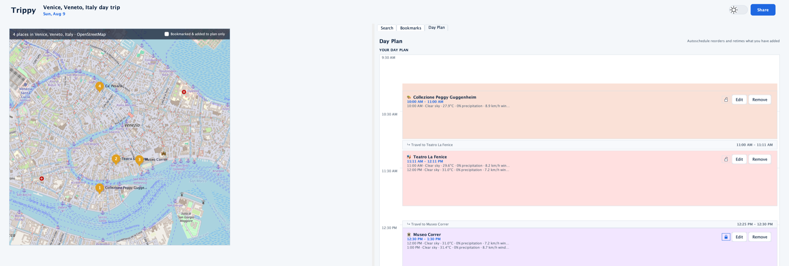
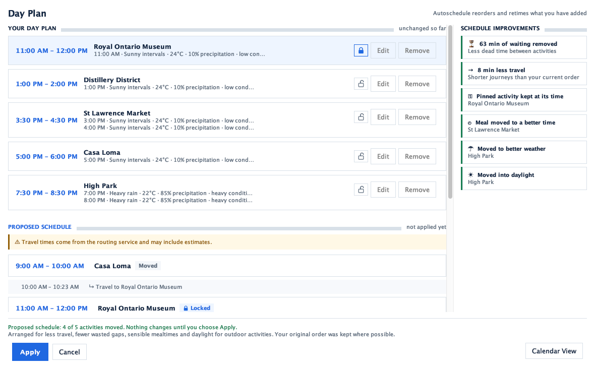
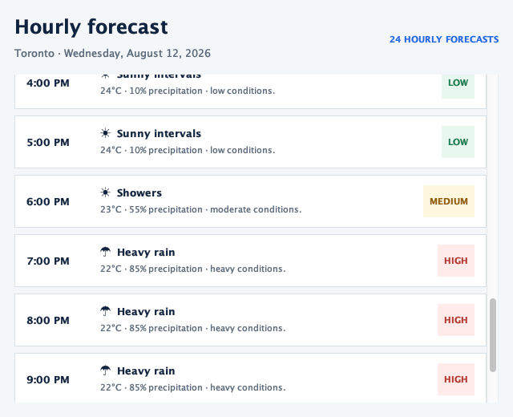

# Trippy — Weather-Aware Desktop Trip Planner

[](https://github.com/kkkaa43/trippy-trip-planner/actions/workflows/java-ci.yml)


Trippy plans a day of travel for you. Pick a destination, discover places from
OpenStreetMap, drop them into a Day Plan, and let the scheduler reorder and retime the day
around opening hours, travel time, mealtimes, daylight, and the hourly forecast. A grounded
AI assistant, George, answers questions about the open itinerary.



> **Team project.** Trippy was built by a five-person team for CSC207 (Software Design) at
> the University of Toronto, Summer 2026. This repository is my portfolio copy of the
> project with its full commit history; see [Team and contributions](#team-and-contributions)
> for who built what.

## Highlights

- **Constraint-aware autoschedule** — previews a better order and timing for the day while
  respecting locked activities, venue hours, availability, and feasible travel, and explains
  every change before anything is saved.
- **Live data with offline fallbacks** — Nominatim/Overpass places, OSRM/TomTom routing, and
  Open-Meteo weather, each behind a gateway with a deterministic mock for offline runs.
- **Grounded AI assistant** — George receives only the current itinerary as context, talks to
  OpenAI through a rate-limited Cloudflare Worker that keeps the API key off the client, and
  falls back to offline guidance when the service is unavailable.
- **Clean Architecture throughout** — entities and use cases never import Swing, HTTP, JSON,
  or Supabase; everything concrete is wired in one composition root, `app.AppBuilder`.
- **Tested and checked in CI** — about 800 JUnit 5 tests run on every push and pull request,
  using fakes and loopback HTTP servers instead of live services.

| Autoschedule preview | Hourly weather |
|---|---|
|  |  |

## Table of contents

- [Highlights](#highlights)
- [Features](#features)
- [Requirements](#requirements)
- [Run the application](#run-the-application)
- [Configuration](#configuration)
- [Activity discovery](#activity-discovery)
- [Day Plan and autoschedule](#day-plan-and-autoschedule)
- [George trip assistant](#george-trip-assistant)
- [Architecture](#architecture)
- [Testing and reports](#testing-and-reports)
- [External services and limitations](#external-services-and-limitations)
- [Web prototype](#web-prototype)
- [Team and contributions](#team-and-contributions)

## Features

- Create, open, and delete single- or multi-day itineraries.
- Discover activities through OpenStreetMap using Nominatim named-place search and
  Overpass nearby discovery.
- Filter activities by category and indoor/outdoor setting.
- View activities on an interactive OpenStreetMap map and select matching cards and pins.
- Bookmark activities and manually add them to the Day Plan.
- Edit, remove, and drag scheduled activities in 15-minute increments.
- Change a day's date and available hours from the Day Plan **Options** dialog.
- Preview and apply an autoscheduled plan using travel, opening hours, availability,
  mealtimes, daylight, weather, and locked activities.
- Review the plan in Day, Week, and Month calendar views.
- View current and hourly weather from Open-Meteo.
- Ask George, the grounded trip assistant, about the open itinerary.
- Use light or dark mode, category colours and icons, keyboard-accessible controls, and
  confirmation prompts for destructive actions.
- Optionally sign in with Supabase, manage friends, share itineraries, and assign View,
  Edit, or Admin access.

## Requirements

- JDK 11 or newer
- Internet access for live places, maps, weather, and George
- Optional Supabase credentials for accounts and cloud persistence
- Optional TomTom API key for traffic-aware driving estimates

Maven does not need to be installed separately; the repository includes the Maven Wrapper.

## Run the application

From the repository root:

### Windows PowerShell

```powershell
.\mvnw.cmd clean test
.\mvnw.cmd compile exec:java
```

### macOS or Linux

```bash
./mvnw clean test
./mvnw compile exec:java
```

The Maven configuration already points to `app.Main`, so no `-Dexec.mainClass` argument is
required. The application opens on **My Trips**. Without Supabase configuration, trips use
in-memory persistence for the current run.

## Configuration

Trippy reads configuration in this order:

1. Java system properties passed with `-D...`
2. Operating-system environment variables
3. A gitignored `.env` file in the repository root

Create `.env` manually only for the services you want to enable:

```dotenv
# Optional account, friend, sharing, and cloud-persistence support
TRIPPY_SUPABASE_URL=https://your-project.supabase.co
TRIPPY_SUPABASE_ANON_KEY=your-anon-key

# Optional traffic-aware driving routes
TOMTOM_API_KEY=your-tomtom-key

# Optional custom George proxy
TRIPPY_AI_PROXY_URL=https://your-worker.example/v1/responses

# Optional direct OpenAI development mode only
OPENAI_API_KEY=your-project-key
OPENAI_MODEL=gpt-5.4-mini
```

Do not add quotation marks or placeholder asterisks around values. Never commit `.env` or
API keys.

### Supabase setup

1. Create a Supabase project.
2. Run [`docs/supabase/schema.sql`](docs/supabase/schema.sql) in its SQL editor.
3. Add `TRIPPY_SUPABASE_URL` and `TRIPPY_SUPABASE_ANON_KEY` to `.env`.
4. Run Trippy from the repository root so `.env` can be found.

When both credentials are present, Supabase mode is enabled automatically. For a classroom
demo, disable email confirmation under **Authentication > Providers > Email** so newly
created accounts can sign in immediately.

### Runtime modes

The desktop entry point defaults to live Nominatim/Overpass places, OpenStreetMap tiles,
Open-Meteo weather, and the configured George proxy. These modes can be overridden:

| Property | Example value | Purpose |
|---|---|---|
| `trippy.places.mode` | `mock` or `nominatim` | Offline fixtures or live place discovery |
| `trippy.weather.mode` | `mock` or `open-meteo` | Offline fixtures or live weather |
| `trippy.map.tiles.mode` | `offline` or `osm` | Offline map or OpenStreetMap tiles |
| `trippy.persistence.mode` | `memory` or `supabase` | Session-only or cloud persistence |
| `trippy.chatbot.mode` | `offline`, `proxy`, or `openai` | George implementation |
| `trippy.nominatim.endpoint` | URL | Override the named-search endpoint |
| `trippy.overpass.endpoint` | URL | Override the nearby-discovery endpoint |

For example, a deterministic offline run in PowerShell is:

```powershell
.\mvnw.cmd compile exec:java `
  "-Dtrippy.places.mode=mock" `
  "-Dtrippy.weather.mode=mock" `
  "-Dtrippy.map.tiles.mode=offline" `
  "-Dtrippy.persistence.mode=memory" `
  "-Dtrippy.chatbot.mode=offline"
```

## Activity discovery

Activity Discovery separates two operations:

- An empty query discovers nearby activities through Overpass.
- A text query finds named places through Nominatim and merges them with indexed local
  results.

`SearchActivitiesUseCase` coordinates the search through application-facing gateways.
Infrastructure adapters handle remote APIs, mapping, caching, stable ordering, partial
results, rate limits, and service failures. Nodes, ways, and relations use type-aware OSM
identities so unrelated objects with the same numeric ID are not merged.

OpenStreetMap does not provide a standardized review rating, so Trippy does not invent or
display ratings. Category and indoor/outdoor values are inferred from OSM tags; incomplete
source data can therefore produce unknown or imperfect classifications.

## Day Plan and autoschedule

Activities can be added manually from Search or Bookmarks. The add dialog proposes the
earliest available interval and also shows the existing plan for drag-and-drop placement.
The Day Plan supports editing, removal, locking, and 15-minute drag rescheduling while
preventing overlaps and keeping events inside the day's available hours.

Autoschedule operates only on activities already in the Day Plan. It produces a preview
before changing saved data and observes these hard constraints:

- day boundaries and user-unavailable periods;
- no overlapping activities or travel;
- locked activities remain at their exact times;
- parsed venue opening hours when available; and
- feasible travel between activities.

It then compares valid schedules using travel time, avoidable waiting, mealtime placement,
daylight, weather when usable, and the user's preference to preserve order. **Apply** saves
the preview; **Cancel** leaves the original plan unchanged.

More detail and the complete autoschedule diagram are in
[`docs/autoschedule/architecture.md`](docs/autoschedule/architecture.md) and
[`docs/autoschedule/diagrams/`](docs/autoschedule/diagrams/).

## George trip assistant

Select George's circular avatar after opening a trip. George receives grounded context from
the current itinerary: destination, date, hours, activities, bookmarks, Day Plan, travel
mode, and weather. The default proxy keeps the OpenAI key outside the desktop application.
If the live assistant is unavailable, Trippy falls back to deterministic offline guidance.

The Cloudflare Worker source is in [`george-proxy`](george-proxy). Direct OpenAI mode is
intended only for local development and must be explicitly enabled with
`-Dtrippy.chatbot.mode=openai`.

## Architecture

```text
entity
  Trip, Activity, ScheduledEvent, WeatherWarning, value objects
      ^
use_case
  interactors, input/output boundaries, repository and service interfaces
      ^
interface_adapter
  controllers, presenters, view models, API and persistence adapters
      ^
views / app / database
  Swing UI, composition root, concrete external services
```

Representative flows include:

```text
SearchPanel
  -> ActivityDiscoveryController
  -> SearchActivitiesUseCase
  -> ActivitySearchGateway
  -> ActivityDiscoveryPresenter
  -> SearchViewModel
```

```text
DayPlanPanel
  -> AutoScheduleController
  -> AutoScheduleInteractor
  -> trip, routing, weather, and scheduling boundaries
  -> AutoSchedulePresenter
  -> DayPlanViewModel
```

The dependency rule points inward: use cases depend on abstractions, while HTTP clients,
JSON mapping, Swing, Supabase, and API-specific behavior remain outside the core.

## Testing and reports

The normal test suite is deterministic and does not require public internet services.
External API behavior is tested with fakes and loopback HTTP servers; explicitly named live
smoke tests are skipped by default.

### Commands

```bash
./mvnw clean test                 # all tests, plus the JaCoCo report in target/site/jacoco/index.html
./mvnw checkstyle:check           # style report -> target/checkstyle-result.xml
open target/site/jacoco/index.html  # coverage report

# opt-in live checks (network required)
RUN_LIVE_AUTOSCHEDULE_TEST=true ./mvnw test -Dtest=AutoScheduleLiveVerificationTest

# conclusive live TomTom driving check (also needs a credential in the environment)
RUN_LIVE_TOMTOM_TEST=true ./mvnw test -Dtest=TomTomLiveVerificationTest
```

Generated reports:

- JaCoCo coverage: `target/site/jacoco/index.html`
- Checkstyle: `target/checkstyle-result.xml`
- Surefire test results: `target/surefire-reports/`

### Report configuration

JaCoCo and Checkstyle are configured as reports rather than build gates, so a threshold or
a legacy style violation cannot block a teammate's commit.

**JaCoCo exclusions (intentional, documented):**

| Excluded | Why |
|---|---|
| `views/**` | Swing rendering; verified by hand / structural tests, not unit-tested for pixels. |
| `interface_adapter/web/**` | Optional REST static-file handler; needs network-style setup. |
| `database/supabase/**` | HTTP adapters for optional cloud auth/persistence (GoTrue + PostgREST). No scheduling or itinerary business rules. Default app mode is in-memory; use cases are tested against ports/fakes. Live cloud checks need credentials/network, so this layer is out of unit coverage like Swing UI. Dual-mode local-vs-cloud routing is covered by `DualModeItineraryDataAccessTest`. |

**Checkstyle uses the official CSC207 configuration.** `config/mystyle.xml` is byte-identical
to the file distributed with the course starter code and named in the regex lecture. The
course ships it for the IntelliJ Checkstyle plugin rather than as a build gate — its own
starter code produces 62 warnings under it — so this project runs it through Maven for
reproducible evidence with `failOnViolation=false`. `pom.xml` pins Checkstyle 10.21.4
because the plugin's bundled version predates two modules the course file uses.

**JaCoCo is 0.8.13 or newer.** 0.8.12 cannot instrument Java 24 class files (major version
68) and floods the build with `IllegalClassFormatException`. Only JDK classes were affected,
so coverage numbers were never wrong, but the noise made the output unreadable.

## External services and limitations

- Nominatim performs geocoding and named-place search.
- Overpass discovers nearby OpenStreetMap activities.
- OpenStreetMap supplies map tiles.
- Open-Meteo supplies geocoding and hourly weather.
- OSRM supplies key-free route estimates; TomTom can provide traffic-aware driving when a
  key is configured.
- Supabase supplies optional authentication, friends, sharing, and persistence.
- Public services can time out, reject traffic, or rate-limit requests. Trippy reports this
  separately from a genuine zero-result search and may show cached partial results.
- Search results depend on the quality and completeness of OpenStreetMap data.
- Venue hours are only as reliable as their OSM `opening_hours` tags.
- The domain uses local dates and times and does not yet model destination time zones.
- Trips are planned one day at a time; a multi-day itinerary contains separate Day Plans.
- There is no hotel/home origin, so routing starts from the destination centre or the prior
  scheduled activity.
- Times are same-day `LocalTime`, so overnight trips and overnight opening hours are not
  supported.
- Autoschedule scoring is deterministic and greedy; it does not guarantee a globally optimal
  itinerary.

## Web prototype

A retained secondary web prototype can be started with:

```powershell
.\mvnw.cmd compile exec:java "-Dexec.args=--web"
```

Its REST API:

- `POST /api/trips`
- `GET /api/trips/{tripId}`
- `PUT /api/trips/{tripId}` — edit itinerary options (destination, date, window, transportation)
- `GET /api/activities`
- `POST|DELETE /api/trips/{tripId}/bookmarks/{activityId}`
- `POST /api/trips/{tripId}/plan/manual`
- `POST /api/trips/{tripId}/plan/autoschedule`
- `PUT|DELETE /api/trips/{tripId}/plan/{eventId}`
- `GET /api/trips/{tripId}/summary`
- `GET /api/trips/{tripId}/share`
- `GET /api/trips/{tripId}/weather`
- `GET /api/trips/{tripId}/weather/hourly`

<a id="contribution"></a>

## Team and contributions

### My contributions — Shiyuan (Dennis) Lyu

- **Project foundation** — set up the Java 11 Maven build, JUnit 5, and the GitHub Actions CI
  pipeline, and established the Clean Architecture dependency composition
  ([`AppBuilder`](src/main/java/app/AppBuilder.java)).
- **First weather-aware scheduler** — the initial autoschedule with scoring policy, schedule
  invariants, and weather weighting, plus the
  [Open-Meteo adapter](src/main/java/interface_adapter/weather/OpenMeteoWeatherService.java)
  and their tests.
- **Create Trip and Trip Setup** — the
  [`CreateTripUseCase`](src/main/java/use_case/usecases/CreateTripUseCase.java) input
  boundary and validation, the Swing create/edit workflow, and active-trip composition across
  every panel.
- **Share Trip** — the full Clean Architecture flow
  ([`ShareTripUseCase`](src/main/java/use_case/usecases/ShareTripUseCase.java)) and a
  clipboard-ready Swing preview.
- **Interactive calendar** — Day, Week, and Month views with synchronized navigation
  ([`CalendarPanel`](src/main/java/views/CalendarPanel.java)).
- **Hourly weather in planning** — live hourly forecasts on activities and the hourly weather
  popup.
- **George trip assistant** — the
  [OpenAI gateway](src/main/java/interface_adapter/ai/OpenAiTripAssistantGateway.java), the
  [offline fallback](src/main/java/interface_adapter/ai/FallbackTripAssistantGateway.java),
  and the [Cloudflare Worker proxy](george-proxy) with input validation and rate limiting.
- **Integration** — reviewed and integrated the map and place-discovery branch, keeping
  offline-by-default service selection and adding adapter and ViewModel tests.

### Teammates

- **Emily Yan** — the final autoschedule Preview/Apply lifecycle, switchable scheduling factors
  and their UI, Day Plan travel repair, and the Checkstyle cleanup.
- **Raashid** — the interactive Swing map, Nominatim/Overpass place discovery and caching,
  multi-day trips, and the package restructuring.
- **Bianca** — Supabase accounts and persistence, friends, View/Edit/Admin trip access, and
  the Edit Itinerary use case.
- **Alex** — Activity Discovery failure handling and search test coverage, plus the
  accessibility report.

Course material, such as the project blueprint, accessibility report, and AI-usage statement,
is kept in [`docs/course`](docs/course). Earlier planning notes and presentation material are
in [`docs/archive`](docs/archive).
